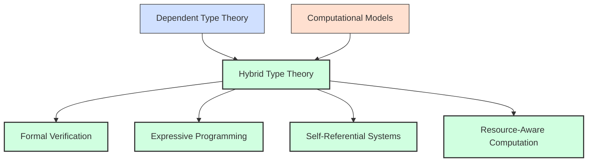
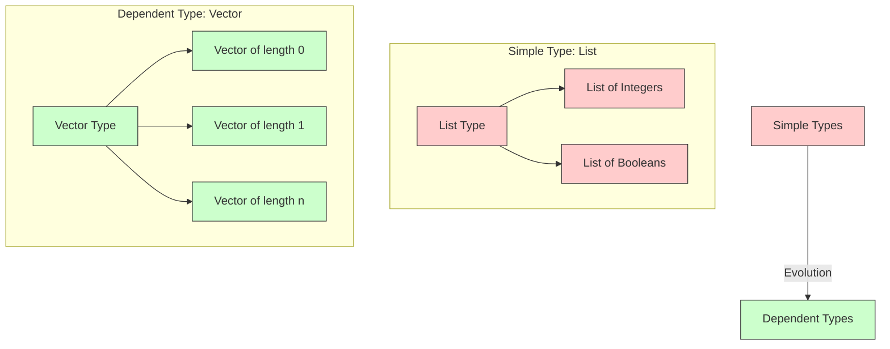
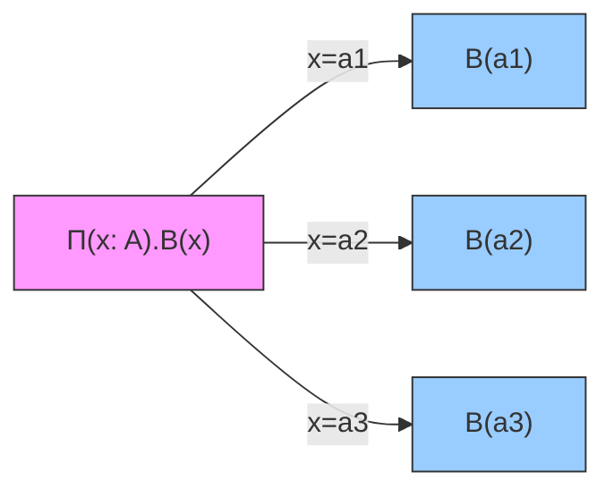
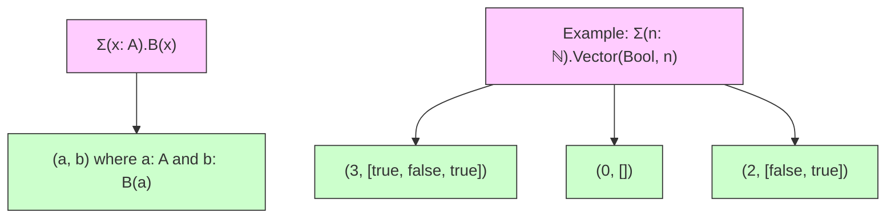
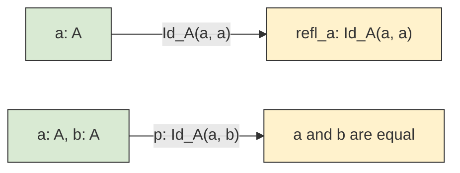
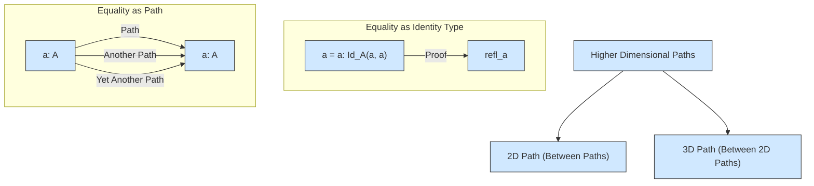
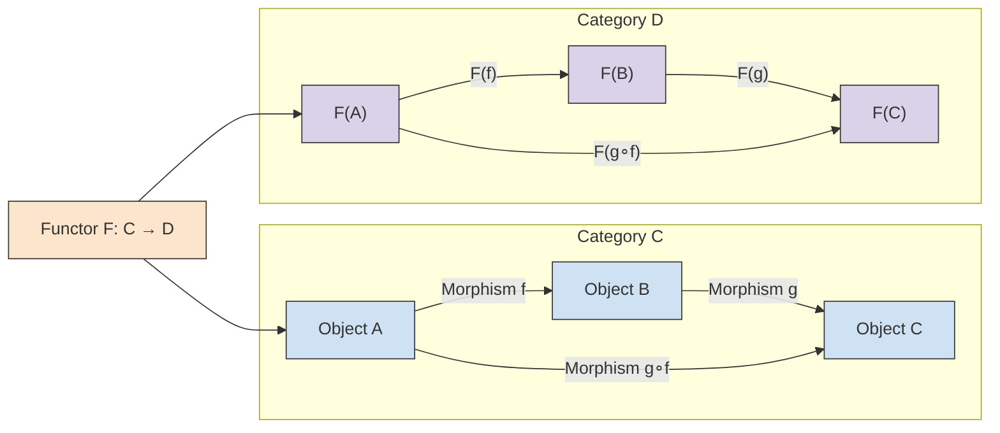
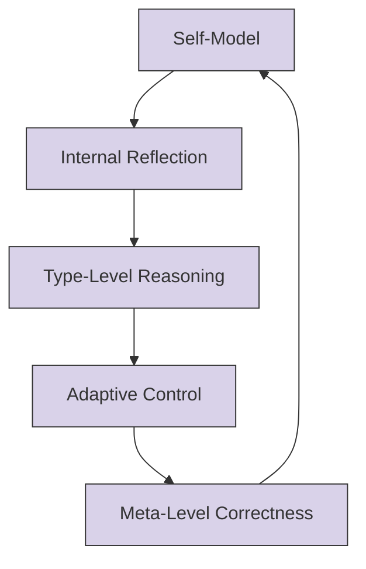
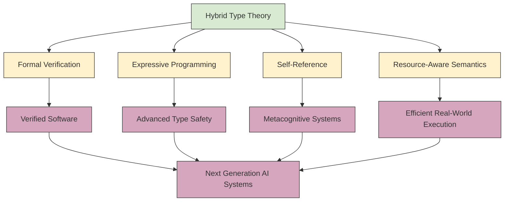

# Hybrid Type Theory
> Bridging Formal Systems and Computational Models

## Introduction

This paper explores the integration of dependent type theory with practical computational models, creating a hybrid framework that maintains formal rigor while accommodating real-world computing constraints. In its strongest form, hybrid type theory is not simply a concatenation of proof theory and programming languages; it is a unified design philosophy for building systems that are simultaneously correct, expressive, and executable. It seeks to preserve the verification power of formal logic while supporting the operational realities of computation: partiality, effects, resource bounds, self-reference, and adaptive control.

The central problem is that purely classical type systems often fail to express the fine-grained properties needed in intelligent, autonomous, and high-assurance software, while unrestricted formal systems can become too rigid, undecidable, or impractical to use at scale. Hybrid type theory therefore sits between two extremes:

- pure proof-theoretic systems, where correctness is exact but expressiveness is often constrained;
- purely computational models, where usability and performance dominate, but semantic guarantees are weaker.

By treating computation as a first-class semantic object and type theory as an organizing principle for trusted reasoning, hybrid type theory aims for a middle path that supports both mathematical precision and engineering practicality.



## Formal Systems

Formal systems provide rigorous frameworks for mathematical reasoning. In Martin-Löf Type Theory, judgments formalize knowledge through precise statements about types and their elements. These judgments serve as the grammar of a logic of meanings: they tell us not only what expressions are, but also how they are judged to be well-formed and equal under the rules of the system.

The foundational idea is that computation and reasoning are not separated domains. Instead, terms inhabit types, and types themselves are subject to formation rules. This yields a tight relationship between syntax and semantics: a well-typed program is a proof, and the structure of the proof determines how the program can be reduced and reasoned about.

| Judgment Form | Meaning | Example |
|---------------|---------|---------|
| a : A | a is an element of type A | 3 : ℕ |
| A : Type | A is a well-formed type | ℕ : Type |
| a ≡ b : A | a and b are definitionally equal elements of type A | 1+1 ≡ 2 : ℕ |
| A ≡ B : Type | A and B are definitionally equal types | List(Bool) ≡ List(Bool) : Type |

### Judgments and Contexts

A judgment is not merely a statement but a relation in a context. A context Γ captures assumptions available to a derivation. For instance, if Γ = x : ℕ, then one may derive x + 0 : ℕ or even x + 0 ≡ x : ℕ under the relevant computation rules. This enriched reasoning is crucial when types depend on values, because the validity of a type can depend on assumptions currently in scope.

In hybrid systems, contexts may include not only ordinary typing assumptions but also computational constraints: effects, resource usage, temporal validity, epistemic assumptions, or trust assumptions. This is one of the main motivations for hybridization: ordinary type theory is often too impoverished to represent operational states in a realistic model.

### Universes and Type Levels

Many formalisms contain a cumulative hierarchy of universes:

- Type₀, Type₁, Type₂, ...

This prevents paradoxes while allowing types to be treated as first-class objects. In practice, universes support generic programming, structures containing types, and higher-order abstractions. In hybrid systems, universes are not just artifacts of metamathematics; they enable the representation of reflection, compile-time reasoning, and model-level distinctions between data, proofs, and programs.

## Dependent Types

Dependent types allow types to depend on values, creating powerful expressivity beyond simple types. A simple function type A → B says that a function takes an input of type A and returns a value of type B. A dependent function type Π(x : A).B(x) says the output type may vary with the actual input value x. This is the general mechanism by which types can encode correctness conditions.



### Expressive Power

Dependent types make it possible to encode propositions as types, where a proof object is a value of that type. A function that takes a natural number n and returns a vector of length n is an example of a value-level specification that is impossible to describe transparently in a non-dependent type system.

For example:

```text
Vec : Nat -> Type
nil : Vec 0
cons : forall {n : Nat}, A -> Vec n -> Vec (n+1)
```

This is not merely an abstract representation. It allows the type checker to reject invalid operations such as indexing beyond the end of a vector when the bound is statically known. It also offers a direct route to verified algorithms: sorting, matrix multiplication, parsing, and cryptographic routines can be proven correct by construction.

### Pi Types (Dependent Function Types)

Pi types (Π) represent dependent function types where the return type may depend on the input value.



A standard use case is a function returning a proof that a number is positive for each input n:

```text
safeDiv : (n : Nat) -> (n > 0) -> Nat
```

This makes the precondition explicit in the type itself. In a hybrid setting, such constraints can be combined with computational conditions such as runtime bounds, memory availability, or sensor validity.

### Sigma Types (Dependent Pair Types)

Sigma types (Σ) represent dependent pair types, allowing the type of the second component to depend on the value of the first. They are the type-theoretic analogue of a record where the second field has a type determined by the first.



Sigma types are crucial in hybrid systems because they package data together with its proof of validity. For example, a system may store a value together with a certificate that it satisfies a safety property, a resource bound, or an authorization condition.

## Identity Types

Identity types formalize equalities between values of a type. The slogan is that proof of equality is encoded by data, and different proofs may be distinguished. This is one of the deepest insights of constructive type theory.



The identity type `Id_A(a, b)` behaves like the proposition “a and b are equal,” but with the crucial twist that it can itself be studied as a type. This leads naturally to the notion that equality is itself a structure with inhabitants, transformations, and symmetries. A proof of equality can be transported across contexts, making type theory especially powerful for rewriting and substitution.

This idea becomes even more radical in homotopy type theory, where equality is treated as a path, and paths can themselves be connected by higher paths.

## Homotopy Type Theory (HoTT)

Homotopy Type Theory reinterprets identity types as paths in space, providing a new geometrical intuition for type theory. Instead of thinking of equality as a purely logical relation, HoTT treats it as a topological notion: a proof that a = b is a path from a to b; equality between equalities is a homotopy, and so on.



The impact of HoTT is profound for hybrid models. It suggests that types are not just static labels but structures with internal geometry. For example, if one encodes state transitions as paths, then one can study equivalences of systems, refinement relations, and invariants up to homotopy. This gives a mathematically rich language for systems that are dynamic, self-modifying, or capable of representing alternative computational worlds.

The relevance to AI and autonomous systems is significant. Self-referential systems, metacognitive loops, and adaptive models often require notions of equivalence finer than mere extensional equality. HoTT offers a framework for understanding such structures in a principled way.

## Category Theory and Dependent Types

Category theory provides an abstract framework that complements type theory through functors and natural transformations. It makes explicit the structural relationships between systems rather than their internal details. In many ways, category theory is the language of composition, abstraction, and transformation.



In type theory, one often identifies types with categories, and terms with morphisms. A functor F : C → D maps structures and morphisms while preserving composition. This yields a foundational bridge between formal specification and computational semantics. For example, a compiler can be seen as a functor from source-language syntax to target-language semantics, and type-directed transformations become naturality conditions.

### The Categorical View of Dependent Types

Dependent types are often modeled using fibrations or families of objects indexed by a base category. This formalizes the idea that the type of a value may vary along a path or under a parameter. Such abstractions make it possible to reason uniformly about indexed structures, refinement types, and parameterized modules.

This perspective is essential in hybrid systems because the computational context itself is often dynamic: a component may be valid under one state, invalid under another, or meaningful only relative to a context. Categorical semantics provide a disciplined way to organize such variation.

## Computational Models

A purely type-theoretic view is often insufficient for real-world software, which is shaped by partiality, side effects, concurrency, and resource boundaries. Hybrid type theory therefore incorporates computational models that are not always total or strictly functional. This is where frameworks such as effect systems, linear types, dependent effects, and modalities become necessary.

### Effects and Purity

In realistic systems, programs may perform I/O, mutate state, throw exceptions, or interact with external environments. A pure type theory often treats these as outside the logic, but a hybrid framework may encode them as effectful computations. A type such as:

```text
IO : Type -> Type
State : S -> Type -> Type
Except : E -> Type -> Type
```

retains the distinction between value and action. This allows the system to model not just what a program computes, but how it interacts with the world.

### Linear and Resource-Aware Types

Resource constraints are central to many important domains: memory, bandwidth, energy, permissions, and capabilities. Linear types allow values to be consumed exactly once, which is useful for representing ownership and state transitions. In hybrid type theory, such constraints can be merged with dependent validation, yielding systems in which resource usage is not merely operational but formally tracked.

For example, a capability to access a locked resource may be represented as a dependent value whose type guarantees the right to use it exactly once and under the correct permission set.

### Graduality and Partial Verification

Not every property is decidable or statically knowable. In real systems, some constraints are too expensive or too dynamically determined to verify at compile time. Gradual type systems introduce a dynamic boundary between statically checked and dynamically checked components. A hybrid type theory can integrate this by allowing the system to reason about both trusted static guarantees and runtime-checked obligations.

This is particularly relevant for AI systems, where uncertainty and adaptability are intrinsic. A model may have a static interface contract while still relying on runtime evidence for learned or probabilistic behavior.

## Self-Reference, Reflection, and Metacognition

One of the most ambitious goals of hybrid type theory is to model systems that reason about themselves. Self-reference is a recurring challenge in foundational mathematics and computation. Type theory traditionally avoids paradox by stratifying universes or incorporating carefully constrained fixed-point operators. Hybrid systems attempt to reconcile this with practical computational reflection.

### Reflection

Reflection allows a system to inspect and manipulate its own structures. A proof assistant may reflect on syntax trees, normalization, tactic state, or generated obligations. In a hybrid framework, reflection is not merely a convenience; it becomes part of the semantics. For example, a verified compiler may generate code and validate it against a type-level specification using metainformation captured in the system itself.

### Self-Referential Systems

Self-reference introduces challenges such as recursive definitions, cyclic proofs, and paradoxical types. The formal solution often involves stratification: the system ensures that a type cannot be defined in terms of itself at the same level without a well-founded escape route. This is analogous to how finite universes prevent Russell-like paradoxes.

Hybrid type theory extends this idea to computational systems that can model agents and metacognitive loops. A system may maintain a type-level model of its own reasoning, thereby creating an internal representation of uncertainty, goals, and assumptions. That is a key step toward systems that can reason about their own correctness and limitations.



## Advanced Topics and Future Directions

The integration of dependent types with computational models presents both opportunities and challenges. A hybrid system must balance expressiveness with decidability, proof discipline with runtime practicality, and abstraction with computational cost.

| Challenge | Potential Solution | Research Direction |
|-----------|-------------------|-------------------|
| Undecidability of type checking | Restricted dependent types | Gradual dependent typing |
| Resource constraints | Linear dependent types | Resource-aware type systems |
| Self-reference paradoxes | Stratified type universes | Homotopy Type Theory |
| Complexity management | Module systems for dependent types | Compositional verification |
| Effectful computation | Dependent effect systems | Verified effectful semantics |
| Uncertainty and learning | Type-level uncertainty models | Probabilistic and adaptive verification |
| Large-scale proof engineering | Hierarchical proofs and automation | AI-assisted formalization |

### Research Frontiers

1. Dependent effects and effect polymorphism. These systems track computational behavior within the type system and offer a path toward verified concurrent and stateful systems.
2. Homotopical semantics for dynamic systems. This offers richer models of equivalence and identity in systems that are not purely extensional.
3. Gradual and partial verification. This addresses the practical reality that not all guarantees can or should be enforced statically.
4. Self-referential and reflective theories. These are essential for systems that model their own reasoning, goals, or adaptation policies.
5. Verified AI and cyber-physical systems. These applications require a bridge between logic, computation, uncertainty, and operational behavior.

## A Unified Perspective

At the heart of hybrid type theory is a simple but powerful principle: types should not merely describe values; they should describe the world in which computation occurs. That world includes proof obligations, resource constraints, environmental assumptions, uncertainty, and dynamic behavior. A robust type system is therefore more than syntax—it is a semantic architecture for trustworthy computation.

This view connects several traditions:

- Martin-Löf type theory gives precision and proof relevance.
- Category theory gives structure and abstraction.
- Programming language theory gives operational semantics and efficiency.
- HoTT gives geometric intuition for identity and equivalence.
- Logic and modal systems give ways to model context, necessity, and change.

The result is a broad framework that supports more than verification. It supports design, specification, adaptation, and the creation of systems that are both formally well-grounded and computationally meaningful.

## Conclusions

Hybrid type theory offers a promising framework for bridging formal mathematical systems with practical computational models. By combining the expressive power of dependent types with the pragmatic concerns of software engineering, we can develop systems that are both formally verified and practically implementable. It extends the reach of traditional type systems beyond static safety into a richer domain that includes effectful computation, resource awareness, self-reference, and reflective reasoning.

This broader vision is increasingly relevant in modern computational science. AI, autonomous systems, scientific software, real-time control, and verified infrastructure all require systems whose correctness is not only syntactic but contextual, structural, and operational. Hybrid type theory provides the conceptual foundation for such systems.



In a sense, hybrid type theory is the mathematics of trustworthy intelligence: a way to make explicit the assumptions, constraints, and proofs that govern computation in an uncertain, adaptive, and evolving world.


